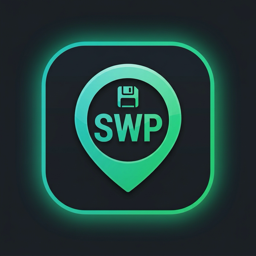

<p align="center">
  
</p>

<h1 align="center">SaveWaypoint</h1>

<p align="center"><i>Pose un point de repère pour tes sauvegardes de jeu.</i></p>

<p align="center">🇺🇸 <a href="README.md">English</a> · 🇫🇷 <b>Français</b></p>

Un plugin [Decky Loader](https://github.com/SteamDeckHomebrew/decky-loader) pour les
consoles Steam Deck / SteamOS qui **détecte automatiquement tes sauvegardes de jeux non-Steam**
(émulateurs, jeux Proton) et les synchronise vers **ton propre dépôt GitHub privé** — pour
reprendre ta progression sur un autre appareil.

> **État : la sauvegarde est prouvée sur du vrai matériel.** La connexion, la détection et la
> sauvegarde ont tourné de bout en bout sur un Steam Deck, et les archives obtenues ont été
> vérifiées comme contenant de vraies données `.sav`.
>
> ⚠️ **La restauration n'a pas encore été exercée sur un appareil.** Le chemin de code est
> testé (aller-retour d'archive, rejet des traversées de chemin et des liens symboliques,
> gestion des permissions), mais personne n'a encore remis une sauvegarde sur une vraie
> console. Fais un essai à blanc — sauvegarde, puis restaure la copie que tu viens de faire —
> avant de t'y fier pour une sauvegarde que tu détesterais perdre.

## Pourquoi

Le Steam Cloud ne couvre que les jeux Steam. Les sauvegardes d'émulateurs, les jeux GOG/itch et
les autres titres non-Steam sont livrés à eux-mêmes. SaveWaypoint trouve ces sauvegardes pour
toi et les garde dans un dépôt git privé que tu contrôles — **aucun serveur chez nous, aucun
abonnement, l'historique git te donne la restauration de version gratuitement.**

### Ce qui le distingue des plugins de sync existants

- **Les jeux Steam sont laissés tranquilles.** Le Steam Cloud les synchronise déjà, et un
  second processus qui le concurrence est pire qu'inutile. `compatdata` contient côte à côte les
  jeux Steam et les raccourcis non-Steam, distingués par AppID (Steam génère des ID de raccourci
  au-dessus de 2³¹) ; seuls les non-Steam sont listés. Activable, pour les jeux que le Steam
  Cloud ne couvre pas.
- **Détection automatique avec un statut de confiance**, au lieu de taper des chemins à la main :
  - 🟢 **Détecté** — un emplacement d'émulateur connu avec des fichiers présents. Synchronisation sûre.
  - 🟡 **Probable** — un dossier qui ressemble à une sauvegarde, trouvé dans un préfixe Proton. Tu
    confirmes avant la synchronisation.
  - 🔴 **Non détecté** — attendu mais vide (par ex. le jeu n'a pas encore sauvegardé).
- **Connexion par téléphone** via le device flow de GitHub — sans clavier ni navigateur sur le Deck.
- **Bouton « Tester cette sauvegarde »** : vérifie qu'une sauvegarde est lisible *et* que son
  dossier est accessible en écriture (restaurable) avant que tu t'y fies.
- **Pas de base de sauvegardes tierce** → aucune contrainte de licence (voir *Légal*).

## Comment fonctionne le stockage

Le dossier de sauvegarde de chaque jeu sélectionné est archivé dans `saves/<id>/backup.tar.gz`
dans un dépôt **privé** de ton compte (par défaut `savewaypoint-saves`). Chaque sauvegarde est un
commit git : l'historique des commits *est* ton historique de versions.

## Configuration unique : le Client ID OAuth GitHub

La connexion par téléphone a besoin d'un Client ID d'**OAuth App** GitHub (gratuit, 2 minutes) :

1. Va dans **GitHub → Settings → Developer settings → OAuth Apps → New OAuth App**.
2. Nom de l'application : `SaveWaypoint` (ce que tu veux). Homepage URL : l'URL de ce dépôt.
   Authorization callback URL : `https://github.com/login/device` (inutilisée par le device flow,
   mais le champ est obligatoire).
3. **Enable Device Flow** (case à cocher sur la page de l'app).
4. Copie le **Client ID** et colle-le dans le premier écran du plugin.

> Le Client ID n'est pas un secret ; on peut l'intégrer sans risque. Les utilisateurs avancés
> peuvent à la place coller un jeton d'accès personnel fine-grained avec la portée `repo`
> (méthode backend `set_pat`).

## Canaux de version

| Canal | Tag | Affiché comme | Qui le reçoit |
|---|---|---|---|
| **Stable** | `v0.1.0` | Latest | tout le monde (par défaut) |
| **Bêta** | `v0.2.0-beta.1` | Pre-release | seulement avec le **canal Bêta** activé dans le plugin |

Le plugin vérifie GitHub une fois par jour et propose la version la plus récente **de ton canal**.
Les mises à jour s'installent via l'installeur de Decky, qui vérifie le SHA-256 du zip avant de
remplacer les fichiers. Désactiver le canal bêta te repropose la version stable (retour arrière).

## Installation

Récupère `SaveWaypoint.zip` depuis la [dernière release](../../releases/latest) — elle est
construite par la CI et contient déjà tout ce dont le plugin a besoin (pas d'étape de build, pas de
paquets Python à installer).

**Option A — installer depuis une URL (le plus simple)**

1. Sur le Deck : **Decky → ⚙️ Settings → General → active le mode développeur**.
2. **Decky → 🔌 Developer → Install Plugin from URL**.
3. Colle l'URL du zip de release et confirme. Terminé.

> Tant que ce dépôt est privé, l'URL nécessite une authentification et cette option échouera —
> utilise l'option B jusqu'à ce que le dépôt soit public.

**Option B — installer depuis un zip sur le Deck**

Copie `SaveWaypoint.zip` sur le Deck, puis en mode Bureau :

```bash
unzip -o SaveWaypoint.zip -d ~/homebrew/plugins/
sudo systemctl restart plugin_loader
```

**Option C — le construire toi-même**

```bash
pnpm install
pnpm run package        # -> release/SaveWaypoint.zip
```

Nécessite Node 20+ et pnpm 9. `pnpm run build` seul ne produit que `dist/index.js`.

## Dépannage

**« network error / SSL: certificate verify failed »**
SteamOS garde son paquet de certificats CA à un endroit où le contexte TLS par défaut de Python
ne regarde pas, donc tous les appels HTTPS échouaient. Corrigé en 0.2.0-beta.2 — mets le plugin à
jour. L'erreur nomme désormais le magasin de certificats réellement utilisé, c'est ce qu'il faut
signaler si elle revient. La vérification des certificats n'est jamais désactivée : ces appels
portent un jeton OAuth.

**« '<quelque chose>' is too short to be a Client ID »**
Tu as collé ton *nom d'utilisateur* GitHub. Le Client ID est généré par GitHub quand tu crées
l'OAuth App et ressemble à `Ov23liAbCdEfGhIjKlMn`. Utilise **Clear Client ID** pour remplacer un
mauvais.

**« this OAuth App does not have Device Flow enabled »**
Ouvre l'app sur github.com et coche **Enable Device Flow**.

## Organisation du code

```
main.py                    backend Decky (classe Plugin, méthodes async)
py_modules/
  detector.py              auto-détection des sauvegardes (émulateurs + scan Proton)
  github_store.py          auth device-flow GitHub + stockage via l'API Contents
  swp_settings.py          réglages JSON locaux
src/index.tsx              frontend React (UI Decky)
scripts/package.sh         construit release/SaveWaypoint.zip
.github/workflows/build.yml  CI : typecheck, compilation, zip, release au tag
```

## Légal

- Le code de ce plugin est sous **MIT**.
- Il n'utilise délibérément **aucune donnée de manifeste PCGamingWiki / Ludusavi**. Les chemins de
  sauvegarde ici sont des faits techniques publics sur chaque émulateur, compilés indépendamment :
  aucune contrainte CC-BY-NC-SA (« non commercial ») ne s'y attache.
- Tes sauvegardes vivent dans *ton* dépôt GitHub, sous *ton* compte.

## Publier une version

```bash
# 1. fixe la version (le tag doit correspondre à package.json)
#    stable : 0.3.0        bêta : 0.3.0-beta.1
# 2. commit, puis tag avec le titre voulu sur la page de release
git tag -a v0.3.0 -m "v0.3.0 — Sauvegarde auto à la fermeture du jeu"
git push origin v0.3.0
```

La CI construit le zip, nomme la release d'après le message du tag et marque tout ce qui contient
`-beta` / `-rc` / `-alpha` comme pre-release.

## Feuille de route

- Sauvegarde automatique à la fermeture du jeu.
- Sélecteur de version dans le plugin (restaurer un commit plus ancien).
- Backends Google Drive / OneDrive optionnels (même abstraction façon rclone).
- Rendu d'un QR code pour le code de connexion.
